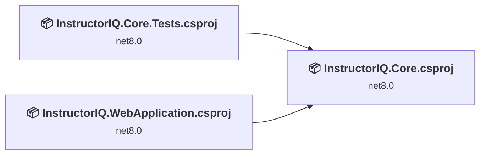
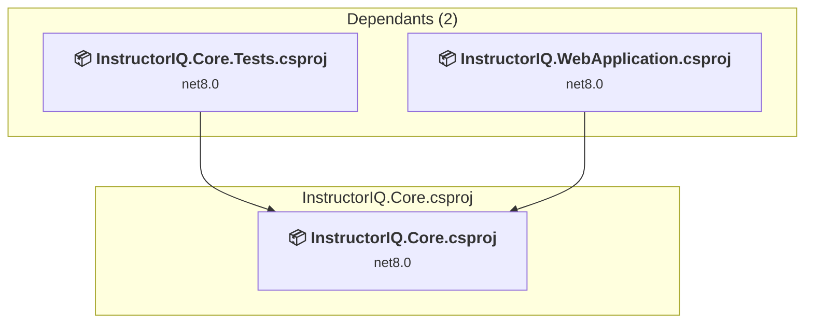
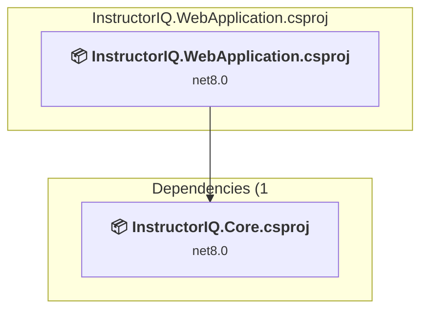
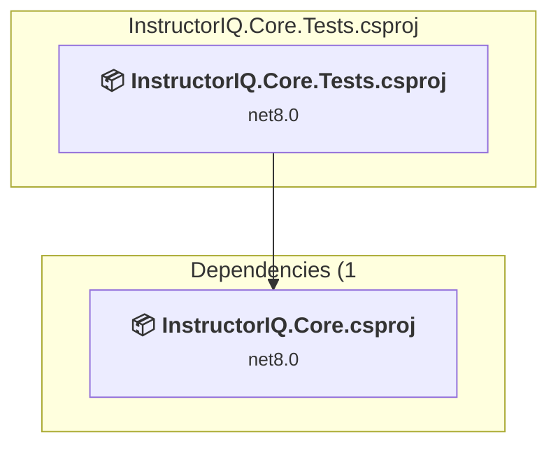

# Projects and dependencies analysis

This document provides a comprehensive overview of the projects and their dependencies in the context of upgrading to .NETCoreApp,Version=v10.0.

## Table of Contents

- [Executive Summary](#executive-Summary)
  - [Highlevel Metrics](#highlevel-metrics)
  - [Projects Compatibility](#projects-compatibility)
  - [Package Compatibility](#package-compatibility)
  - [API Compatibility](#api-compatibility)
  - [Binding Redirect Configuration](#binding-redirect-configuration)
- [Aggregate NuGet packages details](#aggregate-nuget-packages-details)
- [Top API Migration Challenges](#top-api-migration-challenges)
  - [Technologies and Features](#technologies-and-features)
  - [Most Frequent API Issues](#most-frequent-api-issues)
- [Projects Relationship Graph](#projects-relationship-graph)
- [Project Details](#project-details)

  - [src\InstructorIQ.Core\InstructorIQ.Core.csproj](#srcinstructoriqcoreinstructoriqcorecsproj)
  - [src\InstructorIQ.WebApplication\InstructorIQ.WebApplication.csproj](#srcinstructoriqwebapplicationinstructoriqwebapplicationcsproj)
  - [test\InstructorIQ.Core.Tests\InstructorIQ.Core.Tests.csproj](#testinstructoriqcoretestsinstructoriqcoretestscsproj)

## Executive Summary

### Highlevel Metrics

| Metric | Count | Status |
| :--- | :---: | :--- |
| Total Projects | 3 | All require upgrade |
| Total NuGet Packages | 287 | 7 need upgrade |
| Total Code Files | 632 |  |
| Total Code Files with Incidents | 16 |  |
| Total Lines of Code | 44152 |  |
| Total Number of Issues | 38 |  |
| Estimated LOC to modify | 28+ | at least 0.1% of codebase |

### Projects Compatibility

| Project | Target Framework | Difficulty | Package Issues | API Issues | Binding Issues | Est. LOC Impact | Description |
| :--- | :---: | :---: | :---: | :---: | :---: | :---: | :--- |
| [src\InstructorIQ.Core\InstructorIQ.Core.csproj](#srcinstructoriqcoreinstructoriqcorecsproj) | net8.0 | 🟢 Low | 4 | 13 | 0 | 13+ | ClassLibrary, Sdk Style = True |
| [src\InstructorIQ.WebApplication\InstructorIQ.WebApplication.csproj](#srcinstructoriqwebapplicationinstructoriqwebapplicationcsproj) | net8.0 | 🟢 Low | 2 | 9 | 0 | 9+ | AspNetCore, Sdk Style = True |
| [test\InstructorIQ.Core.Tests\InstructorIQ.Core.Tests.csproj](#testinstructoriqcoretestsinstructoriqcoretestscsproj) | net8.0 | 🟢 Low | 1 | 6 | 0 | 6+ | DotNetCoreApp, Sdk Style = True |

### Package Compatibility

| Status | Count | Percentage |
| :--- | :---: | :---: |
| ✅ Compatible | 280 | 97.6% |
| ⚠️ Incompatible | 4 | 1.4% |
| 🔄 Upgrade Recommended | 3 | 1.0% |
| ***Total NuGet Packages*** | ***287*** | ***100%*** |

### API Compatibility

| Category | Count | Impact |
| :--- | :---: | :--- |
| 🔴 Binary Incompatible | 1 | High - Require code changes |
| 🟡 Source Incompatible | 16 | Medium - Needs re-compilation and potential conflicting API error fixing |
| 🔵 Behavioral change | 11 | Low - Behavioral changes that may require testing at runtime |
| ✅ Compatible | 123143 |  |
| ***Total APIs Analyzed*** | ***123171*** |  |

## Aggregate NuGet packages details

| Package | Current Version | Suggested Version | Projects | Description |
| :--- | :---: | :---: | :--- | :--- |
| AngleSharp | 1.8.5 |  | [InstructorIQ.Core.csproj](#srcinstructoriqcoreinstructoriqcorecsproj) [InstructorIQ.Core.Tests.csproj](#testinstructoriqcoretestsinstructoriqcoretestscsproj) [InstructorIQ.WebApplication.csproj](#srcinstructoriqwebapplicationinstructoriqwebapplicationcsproj) | ✅Compatible |
| Apache.Arrow | 22.1.0 |  | [InstructorIQ.Core.csproj](#srcinstructoriqcoreinstructoriqcorecsproj) [InstructorIQ.Core.Tests.csproj](#testinstructoriqcoretestsinstructoriqcoretestscsproj) [InstructorIQ.WebApplication.csproj](#srcinstructoriqwebapplicationinstructoriqwebapplicationcsproj) | ✅Compatible |
| AssemblyMetadata.Generators | 2.2.0 |  | [InstructorIQ.Core.csproj](#srcinstructoriqcoreinstructoriqcorecsproj) [InstructorIQ.Core.Tests.csproj](#testinstructoriqcoretestsinstructoriqcoretestscsproj) [InstructorIQ.WebApplication.csproj](#srcinstructoriqwebapplicationinstructoriqwebapplicationcsproj) | ✅Compatible |
| AutoMapper | 14.0.0 |  | [InstructorIQ.Core.csproj](#srcinstructoriqcoreinstructoriqcorecsproj) [InstructorIQ.Core.Tests.csproj](#testinstructoriqcoretestsinstructoriqcoretestscsproj) [InstructorIQ.WebApplication.csproj](#srcinstructoriqwebapplicationinstructoriqwebapplicationcsproj) | ✅Compatible |
| Azure.Core | 1.62.0 |  | [InstructorIQ.Core.csproj](#srcinstructoriqcoreinstructoriqcorecsproj) [InstructorIQ.Core.Tests.csproj](#testinstructoriqcoretestsinstructoriqcoretestscsproj) [InstructorIQ.WebApplication.csproj](#srcinstructoriqwebapplicationinstructoriqwebapplicationcsproj) | ✅Compatible |
| Azure.Data.Tables | 12.13.0 |  | [InstructorIQ.Core.csproj](#srcinstructoriqcoreinstructoriqcorecsproj) [InstructorIQ.Core.Tests.csproj](#testinstructoriqcoretestsinstructoriqcoretestscsproj) [InstructorIQ.WebApplication.csproj](#srcinstructoriqwebapplicationinstructoriqwebapplicationcsproj) | ✅Compatible |
| Azure.Storage.Blobs | 12.30.1 |  | [InstructorIQ.Core.csproj](#srcinstructoriqcoreinstructoriqcorecsproj) [InstructorIQ.Core.Tests.csproj](#testinstructoriqcoretestsinstructoriqcoretestscsproj) [InstructorIQ.WebApplication.csproj](#srcinstructoriqwebapplicationinstructoriqwebapplicationcsproj) | ✅Compatible |
| Azure.Storage.Common | 12.29.0 |  | [InstructorIQ.Core.csproj](#srcinstructoriqcoreinstructoriqcorecsproj) [InstructorIQ.Core.Tests.csproj](#testinstructoriqcoretestsinstructoriqcoretestscsproj) [InstructorIQ.WebApplication.csproj](#srcinstructoriqwebapplicationinstructoriqwebapplicationcsproj) | ✅Compatible |
| Bogus | 35.6.5 |  | [InstructorIQ.Core.Tests.csproj](#testinstructoriqcoretestsinstructoriqcoretestscsproj) | ✅Compatible |
| BuildBundlerMinifier | 3.2.449 |  | [InstructorIQ.WebApplication.csproj](#srcinstructoriqwebapplicationinstructoriqwebapplicationcsproj) | ✅Compatible |
| CommonMark.NET | 0.15.1 |  | [InstructorIQ.WebApplication.csproj](#srcinstructoriqwebapplicationinstructoriqwebapplicationcsproj) | ✅Compatible |
| coverlet.msbuild | 10.1.0 |  | [InstructorIQ.Core.Tests.csproj](#testinstructoriqcoretestsinstructoriqcoretestscsproj) | ✅Compatible |
| CsvHelper | 33.1.0 |  | [InstructorIQ.Core.csproj](#srcinstructoriqcoreinstructoriqcorecsproj) [InstructorIQ.Core.Tests.csproj](#testinstructoriqcoretestsinstructoriqcoretestscsproj) [InstructorIQ.WebApplication.csproj](#srcinstructoriqwebapplicationinstructoriqwebapplicationcsproj) | ✅Compatible |
| EntityChange | 6.0.1 |  | [InstructorIQ.Core.csproj](#srcinstructoriqcoreinstructoriqcorecsproj) [InstructorIQ.Core.Tests.csproj](#testinstructoriqcoretestsinstructoriqcoretestscsproj) [InstructorIQ.WebApplication.csproj](#srcinstructoriqwebapplicationinstructoriqwebapplicationcsproj) | ✅Compatible |
| FluentAssertions | 8.11.0 |  | [InstructorIQ.Core.Tests.csproj](#testinstructoriqcoretestsinstructoriqcoretestscsproj) | ✅Compatible |
| FluentCommand | 16.1.5 |  | [InstructorIQ.Core.csproj](#srcinstructoriqcoreinstructoriqcorecsproj) [InstructorIQ.Core.Tests.csproj](#testinstructoriqcoretestsinstructoriqcoretestscsproj) [InstructorIQ.WebApplication.csproj](#srcinstructoriqwebapplicationinstructoriqwebapplicationcsproj) | ✅Compatible |
| FluentCommand.Import | 16.1.5 |  | [InstructorIQ.Core.csproj](#srcinstructoriqcoreinstructoriqcorecsproj) [InstructorIQ.Core.Tests.csproj](#testinstructoriqcoretestsinstructoriqcoretestscsproj) [InstructorIQ.WebApplication.csproj](#srcinstructoriqwebapplicationinstructoriqwebapplicationcsproj) | ✅Compatible |
| FluentCommand.SqlServer | 16.1.5 |  | [InstructorIQ.Core.csproj](#srcinstructoriqcoreinstructoriqcorecsproj) [InstructorIQ.Core.Tests.csproj](#testinstructoriqcoretestsinstructoriqcoretestscsproj) [InstructorIQ.WebApplication.csproj](#srcinstructoriqwebapplicationinstructoriqwebapplicationcsproj) | ✅Compatible |
| FluentValidation | 11.11.0 |  | [InstructorIQ.Core.csproj](#srcinstructoriqcoreinstructoriqcorecsproj) [InstructorIQ.Core.Tests.csproj](#testinstructoriqcoretestsinstructoriqcoretestscsproj) [InstructorIQ.WebApplication.csproj](#srcinstructoriqwebapplicationinstructoriqwebapplicationcsproj) | ✅Compatible |
| FluentValidation.AspNetCore | 11.3.1 |  | [InstructorIQ.WebApplication.csproj](#srcinstructoriqwebapplicationinstructoriqwebapplicationcsproj) | ⚠️NuGet package is deprecated |
| FluentValidation.DependencyInjectionExtensions | 11.11.0 |  | [InstructorIQ.WebApplication.csproj](#srcinstructoriqwebapplicationinstructoriqwebapplicationcsproj) | ✅Compatible |
| Handlebars.Net | 2.4.3 |  | [InstructorIQ.Core.csproj](#srcinstructoriqcoreinstructoriqcorecsproj) [InstructorIQ.Core.Tests.csproj](#testinstructoriqcoretestsinstructoriqcoretestscsproj) [InstructorIQ.WebApplication.csproj](#srcinstructoriqwebapplicationinstructoriqwebapplicationcsproj) | ✅Compatible |
| Humanizer | 2.14.1 |  | [InstructorIQ.WebApplication.csproj](#srcinstructoriqwebapplicationinstructoriqwebapplicationcsproj) | ✅Compatible |
| Humanizer.Core | 2.14.1 |  | [InstructorIQ.WebApplication.csproj](#srcinstructoriqwebapplicationinstructoriqwebapplicationcsproj) | ✅Compatible |
| Humanizer.Core.af | 2.14.1 |  | [InstructorIQ.WebApplication.csproj](#srcinstructoriqwebapplicationinstructoriqwebapplicationcsproj) | ✅Compatible |
| Humanizer.Core.ar | 2.14.1 |  | [InstructorIQ.WebApplication.csproj](#srcinstructoriqwebapplicationinstructoriqwebapplicationcsproj) | ✅Compatible |
| Humanizer.Core.az | 2.14.1 |  | [InstructorIQ.WebApplication.csproj](#srcinstructoriqwebapplicationinstructoriqwebapplicationcsproj) | ✅Compatible |
| Humanizer.Core.bg | 2.14.1 |  | [InstructorIQ.WebApplication.csproj](#srcinstructoriqwebapplicationinstructoriqwebapplicationcsproj) | ✅Compatible |
| Humanizer.Core.bn-BD | 2.14.1 |  | [InstructorIQ.WebApplication.csproj](#srcinstructoriqwebapplicationinstructoriqwebapplicationcsproj) | ✅Compatible |
| Humanizer.Core.cs | 2.14.1 |  | [InstructorIQ.WebApplication.csproj](#srcinstructoriqwebapplicationinstructoriqwebapplicationcsproj) | ✅Compatible |
| Humanizer.Core.da | 2.14.1 |  | [InstructorIQ.WebApplication.csproj](#srcinstructoriqwebapplicationinstructoriqwebapplicationcsproj) | ✅Compatible |
| Humanizer.Core.de | 2.14.1 |  | [InstructorIQ.WebApplication.csproj](#srcinstructoriqwebapplicationinstructoriqwebapplicationcsproj) | ✅Compatible |
| Humanizer.Core.el | 2.14.1 |  | [InstructorIQ.WebApplication.csproj](#srcinstructoriqwebapplicationinstructoriqwebapplicationcsproj) | ✅Compatible |
| Humanizer.Core.es | 2.14.1 |  | [InstructorIQ.WebApplication.csproj](#srcinstructoriqwebapplicationinstructoriqwebapplicationcsproj) | ✅Compatible |
| Humanizer.Core.fa | 2.14.1 |  | [InstructorIQ.WebApplication.csproj](#srcinstructoriqwebapplicationinstructoriqwebapplicationcsproj) | ✅Compatible |
| Humanizer.Core.fi-FI | 2.14.1 |  | [InstructorIQ.WebApplication.csproj](#srcinstructoriqwebapplicationinstructoriqwebapplicationcsproj) | ✅Compatible |
| Humanizer.Core.fr | 2.14.1 |  | [InstructorIQ.WebApplication.csproj](#srcinstructoriqwebapplicationinstructoriqwebapplicationcsproj) | ✅Compatible |
| Humanizer.Core.fr-BE | 2.14.1 |  | [InstructorIQ.WebApplication.csproj](#srcinstructoriqwebapplicationinstructoriqwebapplicationcsproj) | ✅Compatible |
| Humanizer.Core.he | 2.14.1 |  | [InstructorIQ.WebApplication.csproj](#srcinstructoriqwebapplicationinstructoriqwebapplicationcsproj) | ✅Compatible |
| Humanizer.Core.hr | 2.14.1 |  | [InstructorIQ.WebApplication.csproj](#srcinstructoriqwebapplicationinstructoriqwebapplicationcsproj) | ✅Compatible |
| Humanizer.Core.hu | 2.14.1 |  | [InstructorIQ.WebApplication.csproj](#srcinstructoriqwebapplicationinstructoriqwebapplicationcsproj) | ✅Compatible |
| Humanizer.Core.hy | 2.14.1 |  | [InstructorIQ.WebApplication.csproj](#srcinstructoriqwebapplicationinstructoriqwebapplicationcsproj) | ✅Compatible |
| Humanizer.Core.id | 2.14.1 |  | [InstructorIQ.WebApplication.csproj](#srcinstructoriqwebapplicationinstructoriqwebapplicationcsproj) | ✅Compatible |
| Humanizer.Core.is | 2.14.1 |  | [InstructorIQ.WebApplication.csproj](#srcinstructoriqwebapplicationinstructoriqwebapplicationcsproj) | ✅Compatible |
| Humanizer.Core.it | 2.14.1 |  | [InstructorIQ.WebApplication.csproj](#srcinstructoriqwebapplicationinstructoriqwebapplicationcsproj) | ✅Compatible |
| Humanizer.Core.ja | 2.14.1 |  | [InstructorIQ.WebApplication.csproj](#srcinstructoriqwebapplicationinstructoriqwebapplicationcsproj) | ✅Compatible |
| Humanizer.Core.ko-KR | 2.14.1 |  | [InstructorIQ.WebApplication.csproj](#srcinstructoriqwebapplicationinstructoriqwebapplicationcsproj) | ✅Compatible |
| Humanizer.Core.ku | 2.14.1 |  | [InstructorIQ.WebApplication.csproj](#srcinstructoriqwebapplicationinstructoriqwebapplicationcsproj) | ✅Compatible |
| Humanizer.Core.lv | 2.14.1 |  | [InstructorIQ.WebApplication.csproj](#srcinstructoriqwebapplicationinstructoriqwebapplicationcsproj) | ✅Compatible |
| Humanizer.Core.ms-MY | 2.14.1 |  | [InstructorIQ.WebApplication.csproj](#srcinstructoriqwebapplicationinstructoriqwebapplicationcsproj) | ✅Compatible |
| Humanizer.Core.mt | 2.14.1 |  | [InstructorIQ.WebApplication.csproj](#srcinstructoriqwebapplicationinstructoriqwebapplicationcsproj) | ✅Compatible |
| Humanizer.Core.nb | 2.14.1 |  | [InstructorIQ.WebApplication.csproj](#srcinstructoriqwebapplicationinstructoriqwebapplicationcsproj) | ✅Compatible |
| Humanizer.Core.nb-NO | 2.14.1 |  | [InstructorIQ.WebApplication.csproj](#srcinstructoriqwebapplicationinstructoriqwebapplicationcsproj) | ✅Compatible |
| Humanizer.Core.nl | 2.14.1 |  | [InstructorIQ.WebApplication.csproj](#srcinstructoriqwebapplicationinstructoriqwebapplicationcsproj) | ✅Compatible |
| Humanizer.Core.pl | 2.14.1 |  | [InstructorIQ.WebApplication.csproj](#srcinstructoriqwebapplicationinstructoriqwebapplicationcsproj) | ✅Compatible |
| Humanizer.Core.pt | 2.14.1 |  | [InstructorIQ.WebApplication.csproj](#srcinstructoriqwebapplicationinstructoriqwebapplicationcsproj) | ✅Compatible |
| Humanizer.Core.ro | 2.14.1 |  | [InstructorIQ.WebApplication.csproj](#srcinstructoriqwebapplicationinstructoriqwebapplicationcsproj) | ✅Compatible |
| Humanizer.Core.ru | 2.14.1 |  | [InstructorIQ.WebApplication.csproj](#srcinstructoriqwebapplicationinstructoriqwebapplicationcsproj) | ✅Compatible |
| Humanizer.Core.sk | 2.14.1 |  | [InstructorIQ.WebApplication.csproj](#srcinstructoriqwebapplicationinstructoriqwebapplicationcsproj) | ✅Compatible |
| Humanizer.Core.sl | 2.14.1 |  | [InstructorIQ.WebApplication.csproj](#srcinstructoriqwebapplicationinstructoriqwebapplicationcsproj) | ✅Compatible |
| Humanizer.Core.sr | 2.14.1 |  | [InstructorIQ.WebApplication.csproj](#srcinstructoriqwebapplicationinstructoriqwebapplicationcsproj) | ✅Compatible |
| Humanizer.Core.sr-Latn | 2.14.1 |  | [InstructorIQ.WebApplication.csproj](#srcinstructoriqwebapplicationinstructoriqwebapplicationcsproj) | ✅Compatible |
| Humanizer.Core.sv | 2.14.1 |  | [InstructorIQ.WebApplication.csproj](#srcinstructoriqwebapplicationinstructoriqwebapplicationcsproj) | ✅Compatible |
| Humanizer.Core.th-TH | 2.14.1 |  | [InstructorIQ.WebApplication.csproj](#srcinstructoriqwebapplicationinstructoriqwebapplicationcsproj) | ✅Compatible |
| Humanizer.Core.tr | 2.14.1 |  | [InstructorIQ.WebApplication.csproj](#srcinstructoriqwebapplicationinstructoriqwebapplicationcsproj) | ✅Compatible |
| Humanizer.Core.uk | 2.14.1 |  | [InstructorIQ.WebApplication.csproj](#srcinstructoriqwebapplicationinstructoriqwebapplicationcsproj) | ✅Compatible |
| Humanizer.Core.uz-Cyrl-UZ | 2.14.1 |  | [InstructorIQ.WebApplication.csproj](#srcinstructoriqwebapplicationinstructoriqwebapplicationcsproj) | ✅Compatible |
| Humanizer.Core.uz-Latn-UZ | 2.14.1 |  | [InstructorIQ.WebApplication.csproj](#srcinstructoriqwebapplicationinstructoriqwebapplicationcsproj) | ✅Compatible |
| Humanizer.Core.vi | 2.14.1 |  | [InstructorIQ.WebApplication.csproj](#srcinstructoriqwebapplicationinstructoriqwebapplicationcsproj) | ✅Compatible |
| Humanizer.Core.zh-CN | 2.14.1 |  | [InstructorIQ.WebApplication.csproj](#srcinstructoriqwebapplicationinstructoriqwebapplicationcsproj) | ✅Compatible |
| Humanizer.Core.zh-Hans | 2.14.1 |  | [InstructorIQ.WebApplication.csproj](#srcinstructoriqwebapplicationinstructoriqwebapplicationcsproj) | ✅Compatible |
| Humanizer.Core.zh-Hant | 2.14.1 |  | [InstructorIQ.WebApplication.csproj](#srcinstructoriqwebapplicationinstructoriqwebapplicationcsproj) | ✅Compatible |
| Ical.Net | 5.2.3 |  | [InstructorIQ.WebApplication.csproj](#srcinstructoriqwebapplicationinstructoriqwebapplicationcsproj) | ✅Compatible |
| Injectio | 6.2.0 |  | [InstructorIQ.Core.csproj](#srcinstructoriqcoreinstructoriqcorecsproj) [InstructorIQ.Core.Tests.csproj](#testinstructoriqcoretestsinstructoriqcoretestscsproj) [InstructorIQ.WebApplication.csproj](#srcinstructoriqwebapplicationinstructoriqwebapplicationcsproj) | ✅Compatible |
| MediatR | 12.4.1 |  | [InstructorIQ.Core.csproj](#srcinstructoriqcoreinstructoriqcorecsproj) [InstructorIQ.Core.Tests.csproj](#testinstructoriqcoretestsinstructoriqcoretestscsproj) [InstructorIQ.WebApplication.csproj](#srcinstructoriqwebapplicationinstructoriqwebapplicationcsproj) | ✅Compatible |
| MediatR.CommandQuery | 16.6.2 |  | [InstructorIQ.Core.csproj](#srcinstructoriqcoreinstructoriqcorecsproj) [InstructorIQ.Core.Tests.csproj](#testinstructoriqcoretestsinstructoriqcoretestscsproj) [InstructorIQ.WebApplication.csproj](#srcinstructoriqwebapplicationinstructoriqwebapplicationcsproj) | ✅Compatible |
| MediatR.CommandQuery.Audit | 16.6.2 |  | [InstructorIQ.Core.csproj](#srcinstructoriqcoreinstructoriqcorecsproj) [InstructorIQ.Core.Tests.csproj](#testinstructoriqcoretestsinstructoriqcoretestscsproj) [InstructorIQ.WebApplication.csproj](#srcinstructoriqwebapplicationinstructoriqwebapplicationcsproj) | ⚠️NuGet package is deprecated |
| MediatR.CommandQuery.EntityFrameworkCore | 16.6.2 |  | [InstructorIQ.Core.csproj](#srcinstructoriqcoreinstructoriqcorecsproj) [InstructorIQ.Core.Tests.csproj](#testinstructoriqcoretestsinstructoriqcoretestscsproj) [InstructorIQ.WebApplication.csproj](#srcinstructoriqwebapplicationinstructoriqwebapplicationcsproj) | ⚠️NuGet package is deprecated |
| MediatR.Contracts | 2.0.1 |  | [InstructorIQ.Core.csproj](#srcinstructoriqcoreinstructoriqcorecsproj) [InstructorIQ.Core.Tests.csproj](#testinstructoriqcoretestsinstructoriqcoretestscsproj) [InstructorIQ.WebApplication.csproj](#srcinstructoriqwebapplicationinstructoriqwebapplicationcsproj) | ✅Compatible |
| Microsoft.AspNetCore.Cryptography.Internal | 8.0.32 |  | [InstructorIQ.Core.csproj](#srcinstructoriqcoreinstructoriqcorecsproj) [InstructorIQ.Core.Tests.csproj](#testinstructoriqcoretestsinstructoriqcoretestscsproj) [InstructorIQ.WebApplication.csproj](#srcinstructoriqwebapplicationinstructoriqwebapplicationcsproj) | ✅Compatible |
| Microsoft.AspNetCore.Cryptography.KeyDerivation | 8.0.32 |  | [InstructorIQ.Core.csproj](#srcinstructoriqcoreinstructoriqcorecsproj) [InstructorIQ.Core.Tests.csproj](#testinstructoriqcoretestsinstructoriqcoretestscsproj) [InstructorIQ.WebApplication.csproj](#srcinstructoriqwebapplicationinstructoriqwebapplicationcsproj) | ✅Compatible |
| Microsoft.AspNetCore.Identity.EntityFrameworkCore | 8.0.32 | 10.0.13 | [InstructorIQ.Core.csproj](#srcinstructoriqcoreinstructoriqcorecsproj) [InstructorIQ.Core.Tests.csproj](#testinstructoriqcoretestsinstructoriqcoretestscsproj) [InstructorIQ.WebApplication.csproj](#srcinstructoriqwebapplicationinstructoriqwebapplicationcsproj) | NuGet package upgrade is recommended |
| Microsoft.AspNetCore.Razor.Language | 6.0.24 |  | [InstructorIQ.WebApplication.csproj](#srcinstructoriqwebapplicationinstructoriqwebapplicationcsproj) | ✅Compatible |
| Microsoft.Bcl.AsyncInterfaces | 10.0.10 |  | [InstructorIQ.Core.csproj](#srcinstructoriqcoreinstructoriqcorecsproj) [InstructorIQ.Core.Tests.csproj](#testinstructoriqcoretestsinstructoriqcoretestscsproj) [InstructorIQ.WebApplication.csproj](#srcinstructoriqwebapplicationinstructoriqwebapplicationcsproj) | ✅Compatible |
| Microsoft.Bcl.Cryptography | 8.0.0 |  | [InstructorIQ.Core.csproj](#srcinstructoriqcoreinstructoriqcorecsproj) [InstructorIQ.Core.Tests.csproj](#testinstructoriqcoretestsinstructoriqcoretestscsproj) [InstructorIQ.WebApplication.csproj](#srcinstructoriqwebapplicationinstructoriqwebapplicationcsproj) | ✅Compatible |
| Microsoft.Build | 17.10.4 |  | [InstructorIQ.WebApplication.csproj](#srcinstructoriqwebapplicationinstructoriqwebapplicationcsproj) | ✅Compatible |
| Microsoft.Build.Framework | 17.10.4 |  | [InstructorIQ.WebApplication.csproj](#srcinstructoriqwebapplicationinstructoriqwebapplicationcsproj) | ✅Compatible |
| Microsoft.CodeAnalysis.Analyzers | 3.3.4 |  | [InstructorIQ.WebApplication.csproj](#srcinstructoriqwebapplicationinstructoriqwebapplicationcsproj) | ✅Compatible |
| Microsoft.CodeAnalysis.AnalyzerUtilities | 3.3.0 |  | [InstructorIQ.WebApplication.csproj](#srcinstructoriqwebapplicationinstructoriqwebapplicationcsproj) | ✅Compatible |
| Microsoft.CodeAnalysis.Common | 4.8.0 |  | [InstructorIQ.WebApplication.csproj](#srcinstructoriqwebapplicationinstructoriqwebapplicationcsproj) | ✅Compatible |
| Microsoft.CodeAnalysis.CSharp | 4.8.0 |  | [InstructorIQ.WebApplication.csproj](#srcinstructoriqwebapplicationinstructoriqwebapplicationcsproj) | ✅Compatible |
| Microsoft.CodeAnalysis.CSharp.Features | 4.8.0 |  | [InstructorIQ.WebApplication.csproj](#srcinstructoriqwebapplicationinstructoriqwebapplicationcsproj) | ✅Compatible |
| Microsoft.CodeAnalysis.CSharp.Workspaces | 4.8.0 |  | [InstructorIQ.WebApplication.csproj](#srcinstructoriqwebapplicationinstructoriqwebapplicationcsproj) | ✅Compatible |
| Microsoft.CodeAnalysis.Elfie | 1.0.0 |  | [InstructorIQ.WebApplication.csproj](#srcinstructoriqwebapplicationinstructoriqwebapplicationcsproj) | ✅Compatible |
| Microsoft.CodeAnalysis.Features | 4.8.0 |  | [InstructorIQ.WebApplication.csproj](#srcinstructoriqwebapplicationinstructoriqwebapplicationcsproj) | ✅Compatible |
| Microsoft.CodeAnalysis.Razor | 6.0.24 |  | [InstructorIQ.WebApplication.csproj](#srcinstructoriqwebapplicationinstructoriqwebapplicationcsproj) | ✅Compatible |
| Microsoft.CodeAnalysis.Scripting.Common | 4.8.0 |  | [InstructorIQ.WebApplication.csproj](#srcinstructoriqwebapplicationinstructoriqwebapplicationcsproj) | ✅Compatible |
| Microsoft.CodeAnalysis.Workspaces.Common | 4.8.0 |  | [InstructorIQ.WebApplication.csproj](#srcinstructoriqwebapplicationinstructoriqwebapplicationcsproj) | ✅Compatible |
| Microsoft.CodeCoverage | 18.11.0 |  | [InstructorIQ.Core.Tests.csproj](#testinstructoriqcoretestsinstructoriqcoretestscsproj) | ✅Compatible |
| Microsoft.CSharp | 4.0.1 |  | [InstructorIQ.Core.csproj](#srcinstructoriqcoreinstructoriqcorecsproj) [InstructorIQ.Core.Tests.csproj](#testinstructoriqcoretestsinstructoriqcoretestscsproj) | ✅Compatible |
| Microsoft.Data.SqlClient | 7.1.1 |  | [InstructorIQ.Core.csproj](#srcinstructoriqcoreinstructoriqcorecsproj) [InstructorIQ.Core.Tests.csproj](#testinstructoriqcoretestsinstructoriqcoretestscsproj) [InstructorIQ.WebApplication.csproj](#srcinstructoriqwebapplicationinstructoriqwebapplicationcsproj) | ✅Compatible |
| Microsoft.Data.SqlClient.Extensions.Abstractions | 7.1.1 |  | [InstructorIQ.Core.csproj](#srcinstructoriqcoreinstructoriqcorecsproj) [InstructorIQ.Core.Tests.csproj](#testinstructoriqcoretestsinstructoriqcoretestscsproj) [InstructorIQ.WebApplication.csproj](#srcinstructoriqwebapplicationinstructoriqwebapplicationcsproj) | ✅Compatible |
| Microsoft.Data.SqlClient.Internal.Logging | 7.1.1 |  | [InstructorIQ.Core.csproj](#srcinstructoriqcoreinstructoriqcorecsproj) [InstructorIQ.Core.Tests.csproj](#testinstructoriqcoretestsinstructoriqcoretestscsproj) [InstructorIQ.WebApplication.csproj](#srcinstructoriqwebapplicationinstructoriqwebapplicationcsproj) | ✅Compatible |
| Microsoft.Data.SqlClient.SNI.runtime | 7.1.0 |  | [InstructorIQ.Core.csproj](#srcinstructoriqcoreinstructoriqcorecsproj) [InstructorIQ.Core.Tests.csproj](#testinstructoriqcoretestsinstructoriqcoretestscsproj) [InstructorIQ.WebApplication.csproj](#srcinstructoriqwebapplicationinstructoriqwebapplicationcsproj) | ✅Compatible |
| Microsoft.DiaSymReader | 2.0.0 |  | [InstructorIQ.WebApplication.csproj](#srcinstructoriqwebapplicationinstructoriqwebapplicationcsproj) | ✅Compatible |
| Microsoft.DotNet.Scaffolding.Shared | 9.0.0 |  | [InstructorIQ.WebApplication.csproj](#srcinstructoriqwebapplicationinstructoriqwebapplicationcsproj) | ✅Compatible |
| Microsoft.EntityFrameworkCore | 9.0.21 |  | [InstructorIQ.Core.csproj](#srcinstructoriqcoreinstructoriqcorecsproj) [InstructorIQ.Core.Tests.csproj](#testinstructoriqcoretestsinstructoriqcoretestscsproj) [InstructorIQ.WebApplication.csproj](#srcinstructoriqwebapplicationinstructoriqwebapplicationcsproj) | ✅Compatible |
| Microsoft.EntityFrameworkCore.Abstractions | 9.0.21 |  | [InstructorIQ.Core.csproj](#srcinstructoriqcoreinstructoriqcorecsproj) [InstructorIQ.Core.Tests.csproj](#testinstructoriqcoretestsinstructoriqcoretestscsproj) [InstructorIQ.WebApplication.csproj](#srcinstructoriqwebapplicationinstructoriqwebapplicationcsproj) | ✅Compatible |
| Microsoft.EntityFrameworkCore.Analyzers | 9.0.21 |  | [InstructorIQ.Core.csproj](#srcinstructoriqcoreinstructoriqcorecsproj) [InstructorIQ.Core.Tests.csproj](#testinstructoriqcoretestsinstructoriqcoretestscsproj) [InstructorIQ.WebApplication.csproj](#srcinstructoriqwebapplicationinstructoriqwebapplicationcsproj) | ✅Compatible |
| Microsoft.EntityFrameworkCore.Relational | 9.0.21 |  | [InstructorIQ.Core.csproj](#srcinstructoriqcoreinstructoriqcorecsproj) [InstructorIQ.Core.Tests.csproj](#testinstructoriqcoretestsinstructoriqcoretestscsproj) [InstructorIQ.WebApplication.csproj](#srcinstructoriqwebapplicationinstructoriqwebapplicationcsproj) | ✅Compatible |
| Microsoft.EntityFrameworkCore.SqlServer | 9.0.21 | 10.0.13 | [InstructorIQ.Core.csproj](#srcinstructoriqcoreinstructoriqcorecsproj) [InstructorIQ.Core.Tests.csproj](#testinstructoriqcoretestsinstructoriqcoretestscsproj) [InstructorIQ.WebApplication.csproj](#srcinstructoriqwebapplicationinstructoriqwebapplicationcsproj) | NuGet package upgrade is recommended |
| Microsoft.Extensions.Caching.Abstractions | 9.0.21 |  | [InstructorIQ.Core.csproj](#srcinstructoriqcoreinstructoriqcorecsproj) [InstructorIQ.Core.Tests.csproj](#testinstructoriqcoretestsinstructoriqcoretestscsproj) [InstructorIQ.WebApplication.csproj](#srcinstructoriqwebapplicationinstructoriqwebapplicationcsproj) | ✅Compatible |
| Microsoft.Extensions.Caching.Memory | 9.0.21 |  | [InstructorIQ.Core.csproj](#srcinstructoriqcoreinstructoriqcorecsproj) [InstructorIQ.Core.Tests.csproj](#testinstructoriqcoretestsinstructoriqcoretestscsproj) [InstructorIQ.WebApplication.csproj](#srcinstructoriqwebapplicationinstructoriqwebapplicationcsproj) | ✅Compatible |
| Microsoft.Extensions.Configuration | 10.0.0 |  | [InstructorIQ.WebApplication.csproj](#srcinstructoriqwebapplicationinstructoriqwebapplicationcsproj) | ✅Compatible |
| Microsoft.Extensions.Configuration | 10.0.11 |  | [InstructorIQ.Core.Tests.csproj](#testinstructoriqcoretestsinstructoriqcoretestscsproj) | ✅Compatible |
| Microsoft.Extensions.Configuration.Abstractions | 10.0.13 |  | [InstructorIQ.Core.csproj](#srcinstructoriqcoreinstructoriqcorecsproj) [InstructorIQ.Core.Tests.csproj](#testinstructoriqcoretestsinstructoriqcoretestscsproj) [InstructorIQ.WebApplication.csproj](#srcinstructoriqwebapplicationinstructoriqwebapplicationcsproj) | ✅Compatible |
| Microsoft.Extensions.Configuration.Binder | 10.0.0 |  | [InstructorIQ.WebApplication.csproj](#srcinstructoriqwebapplicationinstructoriqwebapplicationcsproj) | ✅Compatible |
| Microsoft.Extensions.Configuration.Binder | 10.0.11 |  | [InstructorIQ.Core.Tests.csproj](#testinstructoriqcoretestsinstructoriqcoretestscsproj) | ✅Compatible |
| Microsoft.Extensions.Configuration.CommandLine | 10.0.11 |  | [InstructorIQ.Core.Tests.csproj](#testinstructoriqcoretestsinstructoriqcoretestscsproj) | ✅Compatible |
| Microsoft.Extensions.Configuration.EnvironmentVariables | 10.0.11 |  | [InstructorIQ.Core.Tests.csproj](#testinstructoriqcoretestsinstructoriqcoretestscsproj) | ✅Compatible |
| Microsoft.Extensions.Configuration.FileExtensions | 10.0.11 |  | [InstructorIQ.Core.Tests.csproj](#testinstructoriqcoretestsinstructoriqcoretestscsproj) | ✅Compatible |
| Microsoft.Extensions.Configuration.Json | 10.0.11 |  | [InstructorIQ.Core.Tests.csproj](#testinstructoriqcoretestsinstructoriqcoretestscsproj) | ✅Compatible |
| Microsoft.Extensions.Configuration.UserSecrets | 10.0.11 |  | [InstructorIQ.Core.Tests.csproj](#testinstructoriqcoretestsinstructoriqcoretestscsproj) | ✅Compatible |
| Microsoft.Extensions.DependencyInjection | 10.0.0 |  | [InstructorIQ.WebApplication.csproj](#srcinstructoriqwebapplicationinstructoriqwebapplicationcsproj) | ✅Compatible |
| Microsoft.Extensions.DependencyInjection | 10.0.11 |  | [InstructorIQ.Core.Tests.csproj](#testinstructoriqcoretestsinstructoriqcoretestscsproj) | ✅Compatible |
| Microsoft.Extensions.DependencyInjection | 9.0.21 |  | [InstructorIQ.Core.csproj](#srcinstructoriqcoreinstructoriqcorecsproj) | ✅Compatible |
| Microsoft.Extensions.DependencyInjection.Abstractions | 10.0.13 |  | [InstructorIQ.Core.csproj](#srcinstructoriqcoreinstructoriqcorecsproj) [InstructorIQ.Core.Tests.csproj](#testinstructoriqcoretestsinstructoriqcoretestscsproj) [InstructorIQ.WebApplication.csproj](#srcinstructoriqwebapplicationinstructoriqwebapplicationcsproj) | ✅Compatible |
| Microsoft.Extensions.DependencyModel | 10.0.0 |  | [InstructorIQ.WebApplication.csproj](#srcinstructoriqwebapplicationinstructoriqwebapplicationcsproj) | ✅Compatible |
| Microsoft.Extensions.Diagnostics | 10.0.11 |  | [InstructorIQ.Core.Tests.csproj](#testinstructoriqcoretestsinstructoriqcoretestscsproj) | ✅Compatible |
| Microsoft.Extensions.Diagnostics.Abstractions | 10.0.10 |  | [InstructorIQ.Core.csproj](#srcinstructoriqcoreinstructoriqcorecsproj) [InstructorIQ.WebApplication.csproj](#srcinstructoriqwebapplicationinstructoriqwebapplicationcsproj) | ✅Compatible |
| Microsoft.Extensions.Diagnostics.Abstractions | 10.0.11 |  | [InstructorIQ.Core.Tests.csproj](#testinstructoriqcoretestsinstructoriqcoretestscsproj) | ✅Compatible |
| Microsoft.Extensions.FileProviders.Abstractions | 10.0.10 |  | [InstructorIQ.Core.csproj](#srcinstructoriqcoreinstructoriqcorecsproj) [InstructorIQ.WebApplication.csproj](#srcinstructoriqwebapplicationinstructoriqwebapplicationcsproj) | ✅Compatible |
| Microsoft.Extensions.FileProviders.Abstractions | 10.0.11 |  | [InstructorIQ.Core.Tests.csproj](#testinstructoriqcoretestsinstructoriqcoretestscsproj) | ✅Compatible |
| Microsoft.Extensions.FileProviders.Physical | 10.0.11 |  | [InstructorIQ.Core.Tests.csproj](#testinstructoriqcoretestsinstructoriqcoretestscsproj) | ✅Compatible |
| Microsoft.Extensions.FileSystemGlobbing | 10.0.11 |  | [InstructorIQ.Core.Tests.csproj](#testinstructoriqcoretestsinstructoriqcoretestscsproj) | ✅Compatible |
| Microsoft.Extensions.Hosting | 10.0.11 |  | [InstructorIQ.Core.Tests.csproj](#testinstructoriqcoretestsinstructoriqcoretestscsproj) | ✅Compatible |
| Microsoft.Extensions.Hosting.Abstractions | 10.0.10 |  | [InstructorIQ.Core.csproj](#srcinstructoriqcoreinstructoriqcorecsproj) [InstructorIQ.WebApplication.csproj](#srcinstructoriqwebapplicationinstructoriqwebapplicationcsproj) | ✅Compatible |
| Microsoft.Extensions.Hosting.Abstractions | 10.0.11 |  | [InstructorIQ.Core.Tests.csproj](#testinstructoriqcoretestsinstructoriqcoretestscsproj) | ✅Compatible |
| Microsoft.Extensions.Http | 2.1.0 |  | [InstructorIQ.Core.csproj](#srcinstructoriqcoreinstructoriqcorecsproj) [InstructorIQ.Core.Tests.csproj](#testinstructoriqcoretestsinstructoriqcoretestscsproj) [InstructorIQ.WebApplication.csproj](#srcinstructoriqwebapplicationinstructoriqwebapplicationcsproj) | ✅Compatible |
| Microsoft.Extensions.Identity.Core | 8.0.32 |  | [InstructorIQ.Core.csproj](#srcinstructoriqcoreinstructoriqcorecsproj) [InstructorIQ.Core.Tests.csproj](#testinstructoriqcoretestsinstructoriqcoretestscsproj) [InstructorIQ.WebApplication.csproj](#srcinstructoriqwebapplicationinstructoriqwebapplicationcsproj) | ✅Compatible |
| Microsoft.Extensions.Identity.Stores | 8.0.32 |  | [InstructorIQ.Core.csproj](#srcinstructoriqcoreinstructoriqcorecsproj) [InstructorIQ.Core.Tests.csproj](#testinstructoriqcoretestsinstructoriqcoretestscsproj) [InstructorIQ.WebApplication.csproj](#srcinstructoriqwebapplicationinstructoriqwebapplicationcsproj) | ✅Compatible |
| Microsoft.Extensions.Logging | 10.0.0 |  | [InstructorIQ.WebApplication.csproj](#srcinstructoriqwebapplicationinstructoriqwebapplicationcsproj) | ✅Compatible |
| Microsoft.Extensions.Logging | 10.0.11 |  | [InstructorIQ.Core.Tests.csproj](#testinstructoriqcoretestsinstructoriqcoretestscsproj) | ✅Compatible |
| Microsoft.Extensions.Logging | 9.0.21 |  | [InstructorIQ.Core.csproj](#srcinstructoriqcoreinstructoriqcorecsproj) | ✅Compatible |
| Microsoft.Extensions.Logging.Abstractions | 10.0.13 |  | [InstructorIQ.Core.csproj](#srcinstructoriqcoreinstructoriqcorecsproj) [InstructorIQ.Core.Tests.csproj](#testinstructoriqcoretestsinstructoriqcoretestscsproj) [InstructorIQ.WebApplication.csproj](#srcinstructoriqwebapplicationinstructoriqwebapplicationcsproj) | ✅Compatible |
| Microsoft.Extensions.Logging.Configuration | 10.0.11 |  | [InstructorIQ.Core.Tests.csproj](#testinstructoriqcoretestsinstructoriqcoretestscsproj) | ✅Compatible |
| Microsoft.Extensions.Logging.Console | 10.0.11 |  | [InstructorIQ.Core.Tests.csproj](#testinstructoriqcoretestsinstructoriqcoretestscsproj) | ✅Compatible |
| Microsoft.Extensions.Logging.Debug | 10.0.11 |  | [InstructorIQ.Core.Tests.csproj](#testinstructoriqcoretestsinstructoriqcoretestscsproj) | ✅Compatible |
| Microsoft.Extensions.Logging.EventLog | 10.0.11 |  | [InstructorIQ.Core.Tests.csproj](#testinstructoriqcoretestsinstructoriqcoretestscsproj) | ✅Compatible |
| Microsoft.Extensions.Logging.EventSource | 10.0.11 |  | [InstructorIQ.Core.Tests.csproj](#testinstructoriqcoretestsinstructoriqcoretestscsproj) | ✅Compatible |
| Microsoft.Extensions.Options | 10.0.10 |  | [InstructorIQ.Core.csproj](#srcinstructoriqcoreinstructoriqcorecsproj) [InstructorIQ.WebApplication.csproj](#srcinstructoriqwebapplicationinstructoriqwebapplicationcsproj) | ✅Compatible |
| Microsoft.Extensions.Options | 10.0.11 |  | [InstructorIQ.Core.Tests.csproj](#testinstructoriqcoretestsinstructoriqcoretestscsproj) | ✅Compatible |
| Microsoft.Extensions.Options.ConfigurationExtensions | 10.0.11 |  | [InstructorIQ.Core.Tests.csproj](#testinstructoriqcoretestsinstructoriqcoretestscsproj) | ✅Compatible |
| Microsoft.Extensions.Primitives | 10.0.13 |  | [InstructorIQ.Core.csproj](#srcinstructoriqcoreinstructoriqcorecsproj) [InstructorIQ.Core.Tests.csproj](#testinstructoriqcoretestsinstructoriqcoretestscsproj) [InstructorIQ.WebApplication.csproj](#srcinstructoriqwebapplicationinstructoriqwebapplicationcsproj) | ✅Compatible |
| Microsoft.Identity.Client | 4.84.2 |  | [InstructorIQ.Core.csproj](#srcinstructoriqcoreinstructoriqcorecsproj) [InstructorIQ.Core.Tests.csproj](#testinstructoriqcoretestsinstructoriqcoretestscsproj) [InstructorIQ.WebApplication.csproj](#srcinstructoriqwebapplicationinstructoriqwebapplicationcsproj) | ✅Compatible |
| Microsoft.Identity.Client.Extensions.Msal | 4.84.2 |  | [InstructorIQ.Core.csproj](#srcinstructoriqcoreinstructoriqcorecsproj) [InstructorIQ.Core.Tests.csproj](#testinstructoriqcoretestsinstructoriqcoretestscsproj) [InstructorIQ.WebApplication.csproj](#srcinstructoriqwebapplicationinstructoriqwebapplicationcsproj) | ✅Compatible |
| Microsoft.IdentityModel.Abstractions | 8.16.0 |  | [InstructorIQ.Core.csproj](#srcinstructoriqcoreinstructoriqcorecsproj) [InstructorIQ.Core.Tests.csproj](#testinstructoriqcoretestsinstructoriqcoretestscsproj) [InstructorIQ.WebApplication.csproj](#srcinstructoriqwebapplicationinstructoriqwebapplicationcsproj) | ✅Compatible |
| Microsoft.IdentityModel.JsonWebTokens | 8.16.0 |  | [InstructorIQ.Core.csproj](#srcinstructoriqcoreinstructoriqcorecsproj) [InstructorIQ.Core.Tests.csproj](#testinstructoriqcoretestsinstructoriqcoretestscsproj) [InstructorIQ.WebApplication.csproj](#srcinstructoriqwebapplicationinstructoriqwebapplicationcsproj) | ✅Compatible |
| Microsoft.IdentityModel.Logging | 8.16.0 |  | [InstructorIQ.Core.csproj](#srcinstructoriqcoreinstructoriqcorecsproj) [InstructorIQ.Core.Tests.csproj](#testinstructoriqcoretestsinstructoriqcoretestscsproj) [InstructorIQ.WebApplication.csproj](#srcinstructoriqwebapplicationinstructoriqwebapplicationcsproj) | ✅Compatible |
| Microsoft.IdentityModel.Protocols | 8.16.0 |  | [InstructorIQ.Core.csproj](#srcinstructoriqcoreinstructoriqcorecsproj) [InstructorIQ.Core.Tests.csproj](#testinstructoriqcoretestsinstructoriqcoretestscsproj) [InstructorIQ.WebApplication.csproj](#srcinstructoriqwebapplicationinstructoriqwebapplicationcsproj) | ✅Compatible |
| Microsoft.IdentityModel.Protocols.OpenIdConnect | 8.16.0 |  | [InstructorIQ.Core.csproj](#srcinstructoriqcoreinstructoriqcorecsproj) [InstructorIQ.Core.Tests.csproj](#testinstructoriqcoretestsinstructoriqcoretestscsproj) [InstructorIQ.WebApplication.csproj](#srcinstructoriqwebapplicationinstructoriqwebapplicationcsproj) | ✅Compatible |
| Microsoft.IdentityModel.Tokens | 8.16.0 |  | [InstructorIQ.Core.csproj](#srcinstructoriqcoreinstructoriqcorecsproj) [InstructorIQ.Core.Tests.csproj](#testinstructoriqcoretestsinstructoriqcoretestscsproj) [InstructorIQ.WebApplication.csproj](#srcinstructoriqwebapplicationinstructoriqwebapplicationcsproj) | ✅Compatible |
| Microsoft.NET.StringTools | 17.10.4 |  | [InstructorIQ.WebApplication.csproj](#srcinstructoriqwebapplicationinstructoriqwebapplicationcsproj) | ✅Compatible |
| Microsoft.NET.Test.Sdk | 18.11.0 |  | [InstructorIQ.Core.Tests.csproj](#testinstructoriqcoretestsinstructoriqcoretestscsproj) | ✅Compatible |
| Microsoft.NETCore.Platforms | 1.0.1 |  | [InstructorIQ.Core.csproj](#srcinstructoriqcoreinstructoriqcorecsproj) [InstructorIQ.Core.Tests.csproj](#testinstructoriqcoretestsinstructoriqcoretestscsproj) | ✅Compatible |
| Microsoft.NETCore.Targets | 1.0.1 |  | [InstructorIQ.Core.csproj](#srcinstructoriqcoreinstructoriqcorecsproj) [InstructorIQ.Core.Tests.csproj](#testinstructoriqcoretestsinstructoriqcoretestscsproj) | ✅Compatible |
| Microsoft.SqlServer.Server | 1.0.0 |  | [InstructorIQ.Core.csproj](#srcinstructoriqcoreinstructoriqcorecsproj) [InstructorIQ.Core.Tests.csproj](#testinstructoriqcoretestsinstructoriqcoretestscsproj) [InstructorIQ.WebApplication.csproj](#srcinstructoriqwebapplicationinstructoriqwebapplicationcsproj) | ✅Compatible |
| Microsoft.TestPlatform.ObjectModel | 18.11.0 |  | [InstructorIQ.Core.Tests.csproj](#testinstructoriqcoretestsinstructoriqcoretestscsproj) | ✅Compatible |
| Microsoft.TestPlatform.TestHost | 18.11.0 |  | [InstructorIQ.Core.Tests.csproj](#testinstructoriqcoretestsinstructoriqcoretestscsproj) | ✅Compatible |
| Microsoft.VisualStudio.Web.CodeGeneration | 9.0.0 |  | [InstructorIQ.WebApplication.csproj](#srcinstructoriqwebapplicationinstructoriqwebapplicationcsproj) | ✅Compatible |
| Microsoft.VisualStudio.Web.CodeGeneration.Core | 9.0.0 |  | [InstructorIQ.WebApplication.csproj](#srcinstructoriqwebapplicationinstructoriqwebapplicationcsproj) | ✅Compatible |
| Microsoft.VisualStudio.Web.CodeGeneration.Design | 9.0.0 | 10.0.2 | [InstructorIQ.WebApplication.csproj](#srcinstructoriqwebapplicationinstructoriqwebapplicationcsproj) | NuGet package upgrade is recommended |
| Microsoft.VisualStudio.Web.CodeGeneration.EntityFrameworkCore | 9.0.0 |  | [InstructorIQ.WebApplication.csproj](#srcinstructoriqwebapplicationinstructoriqwebapplicationcsproj) | ✅Compatible |
| Microsoft.VisualStudio.Web.CodeGeneration.Templating | 9.0.0 |  | [InstructorIQ.WebApplication.csproj](#srcinstructoriqwebapplicationinstructoriqwebapplicationcsproj) | ✅Compatible |
| Microsoft.VisualStudio.Web.CodeGeneration.Utils | 9.0.0 |  | [InstructorIQ.WebApplication.csproj](#srcinstructoriqwebapplicationinstructoriqwebapplicationcsproj) | ✅Compatible |
| Microsoft.VisualStudio.Web.CodeGenerators.Mvc | 9.0.0 |  | [InstructorIQ.WebApplication.csproj](#srcinstructoriqwebapplicationinstructoriqwebapplicationcsproj) | ✅Compatible |
| MinVer | 8.0.0 |  | [InstructorIQ.Core.csproj](#srcinstructoriqcoreinstructoriqcorecsproj) [InstructorIQ.Core.Tests.csproj](#testinstructoriqcoretestsinstructoriqcoretestscsproj) [InstructorIQ.WebApplication.csproj](#srcinstructoriqwebapplicationinstructoriqwebapplicationcsproj) | ✅Compatible |
| Mono.TextTemplating | 3.0.0 |  | [InstructorIQ.WebApplication.csproj](#srcinstructoriqwebapplicationinstructoriqwebapplicationcsproj) | ✅Compatible |
| NaturalSort.Extension | 4.4.1 |  | [InstructorIQ.Core.csproj](#srcinstructoriqcoreinstructoriqcorecsproj) [InstructorIQ.Core.Tests.csproj](#testinstructoriqcoretestsinstructoriqcoretestscsproj) [InstructorIQ.WebApplication.csproj](#srcinstructoriqwebapplicationinstructoriqwebapplicationcsproj) | ✅Compatible |
| NetEscapades.AspNetCore.SecurityHeaders | 1.3.1 |  | [InstructorIQ.WebApplication.csproj](#srcinstructoriqwebapplicationinstructoriqwebapplicationcsproj) | ✅Compatible |
| Newtonsoft.Json | 13.0.3 |  | [InstructorIQ.WebApplication.csproj](#srcinstructoriqwebapplicationinstructoriqwebapplicationcsproj) | ✅Compatible |
| Newtonsoft.Json | 9.0.1 |  | [InstructorIQ.Core.csproj](#srcinstructoriqcoreinstructoriqcorecsproj) [InstructorIQ.Core.Tests.csproj](#testinstructoriqcoretestsinstructoriqcoretestscsproj) | ✅Compatible |
| NodaTime | 3.2.2 |  | [InstructorIQ.WebApplication.csproj](#srcinstructoriqwebapplicationinstructoriqwebapplicationcsproj) | ✅Compatible |
| NuGet.Common | 6.11.0 |  | [InstructorIQ.WebApplication.csproj](#srcinstructoriqwebapplicationinstructoriqwebapplicationcsproj) | ✅Compatible |
| NuGet.Configuration | 6.11.0 |  | [InstructorIQ.WebApplication.csproj](#srcinstructoriqwebapplicationinstructoriqwebapplicationcsproj) | ✅Compatible |
| NuGet.DependencyResolver.Core | 6.11.0 |  | [InstructorIQ.WebApplication.csproj](#srcinstructoriqwebapplicationinstructoriqwebapplicationcsproj) | ✅Compatible |
| NuGet.Frameworks | 6.11.0 |  | [InstructorIQ.WebApplication.csproj](#srcinstructoriqwebapplicationinstructoriqwebapplicationcsproj) | ✅Compatible |
| NuGet.LibraryModel | 6.11.0 |  | [InstructorIQ.WebApplication.csproj](#srcinstructoriqwebapplicationinstructoriqwebapplicationcsproj) | ✅Compatible |
| NuGet.Packaging | 6.11.0 |  | [InstructorIQ.WebApplication.csproj](#srcinstructoriqwebapplicationinstructoriqwebapplicationcsproj) | ✅Compatible |
| NuGet.ProjectModel | 6.11.0 |  | [InstructorIQ.WebApplication.csproj](#srcinstructoriqwebapplicationinstructoriqwebapplicationcsproj) | ✅Compatible |
| NuGet.Protocol | 6.11.0 |  | [InstructorIQ.WebApplication.csproj](#srcinstructoriqwebapplicationinstructoriqwebapplicationcsproj) | ✅Compatible |
| NuGet.Versioning | 6.11.0 |  | [InstructorIQ.WebApplication.csproj](#srcinstructoriqwebapplicationinstructoriqwebapplicationcsproj) | ✅Compatible |
| SendGrid | 9.24.3 |  | [InstructorIQ.Core.csproj](#srcinstructoriqcoreinstructoriqcorecsproj) [InstructorIQ.Core.Tests.csproj](#testinstructoriqcoretestsinstructoriqcoretestscsproj) [InstructorIQ.WebApplication.csproj](#srcinstructoriqwebapplicationinstructoriqwebapplicationcsproj) | ✅Compatible |
| SendGrid.Extensions.DependencyInjection | 1.0.1 |  | [InstructorIQ.Core.csproj](#srcinstructoriqcoreinstructoriqcorecsproj) [InstructorIQ.Core.Tests.csproj](#testinstructoriqcoretestsinstructoriqcoretestscsproj) [InstructorIQ.WebApplication.csproj](#srcinstructoriqwebapplicationinstructoriqwebapplicationcsproj) | ✅Compatible |
| Serilog | 4.3.0 |  | [InstructorIQ.WebApplication.csproj](#srcinstructoriqwebapplicationinstructoriqwebapplicationcsproj) | ✅Compatible |
| Serilog.AspNetCore | 10.0.0 |  | [InstructorIQ.WebApplication.csproj](#srcinstructoriqwebapplicationinstructoriqwebapplicationcsproj) | ✅Compatible |
| Serilog.Extensions.Hosting | 10.0.0 |  | [InstructorIQ.WebApplication.csproj](#srcinstructoriqwebapplicationinstructoriqwebapplicationcsproj) | ✅Compatible |
| Serilog.Extensions.Logging | 10.0.0 |  | [InstructorIQ.WebApplication.csproj](#srcinstructoriqwebapplicationinstructoriqwebapplicationcsproj) | ✅Compatible |
| Serilog.Formatting.Compact | 3.0.0 |  | [InstructorIQ.WebApplication.csproj](#srcinstructoriqwebapplicationinstructoriqwebapplicationcsproj) | ✅Compatible |
| Serilog.Settings.Configuration | 10.0.0 |  | [InstructorIQ.WebApplication.csproj](#srcinstructoriqwebapplicationinstructoriqwebapplicationcsproj) | ✅Compatible |
| Serilog.Sinks.AzureTableStorage | 10.2.0 |  | [InstructorIQ.WebApplication.csproj](#srcinstructoriqwebapplicationinstructoriqwebapplicationcsproj) | ✅Compatible |
| Serilog.Sinks.Console | 6.1.1 |  | [InstructorIQ.WebApplication.csproj](#srcinstructoriqwebapplicationinstructoriqwebapplicationcsproj) | ✅Compatible |
| Serilog.Sinks.Debug | 3.0.0 |  | [InstructorIQ.WebApplication.csproj](#srcinstructoriqwebapplicationinstructoriqwebapplicationcsproj) | ✅Compatible |
| Serilog.Sinks.File | 7.0.0 |  | [InstructorIQ.WebApplication.csproj](#srcinstructoriqwebapplicationinstructoriqwebapplicationcsproj) | ✅Compatible |
| starkbank-ecdsa | 1.3.1 |  | [InstructorIQ.Core.csproj](#srcinstructoriqcoreinstructoriqcorecsproj) [InstructorIQ.Core.Tests.csproj](#testinstructoriqcoretestsinstructoriqcoretestscsproj) [InstructorIQ.WebApplication.csproj](#srcinstructoriqwebapplicationinstructoriqwebapplicationcsproj) | ✅Compatible |
| System.ClientModel | 1.15.0 |  | [InstructorIQ.Core.csproj](#srcinstructoriqcoreinstructoriqcorecsproj) [InstructorIQ.Core.Tests.csproj](#testinstructoriqcoretestsinstructoriqcoretestscsproj) [InstructorIQ.WebApplication.csproj](#srcinstructoriqwebapplicationinstructoriqwebapplicationcsproj) | ✅Compatible |
| System.CodeDom | 6.0.0 |  | [InstructorIQ.WebApplication.csproj](#srcinstructoriqwebapplicationinstructoriqwebapplicationcsproj) | ✅Compatible |
| System.Collections | 4.0.11 |  | [InstructorIQ.Core.csproj](#srcinstructoriqcoreinstructoriqcorecsproj) [InstructorIQ.Core.Tests.csproj](#testinstructoriqcoretestsinstructoriqcoretestscsproj) | ✅Compatible |
| System.Collections.Immutable | 8.0.0 |  | [InstructorIQ.WebApplication.csproj](#srcinstructoriqwebapplicationinstructoriqwebapplicationcsproj) | ✅Compatible |
| System.Composition | 7.0.0 |  | [InstructorIQ.WebApplication.csproj](#srcinstructoriqwebapplicationinstructoriqwebapplicationcsproj) | ✅Compatible |
| System.Composition.AttributedModel | 7.0.0 |  | [InstructorIQ.WebApplication.csproj](#srcinstructoriqwebapplicationinstructoriqwebapplicationcsproj) | ✅Compatible |
| System.Composition.Convention | 7.0.0 |  | [InstructorIQ.WebApplication.csproj](#srcinstructoriqwebapplicationinstructoriqwebapplicationcsproj) | ✅Compatible |
| System.Composition.Hosting | 7.0.0 |  | [InstructorIQ.WebApplication.csproj](#srcinstructoriqwebapplicationinstructoriqwebapplicationcsproj) | ✅Compatible |
| System.Composition.Runtime | 7.0.0 |  | [InstructorIQ.WebApplication.csproj](#srcinstructoriqwebapplicationinstructoriqwebapplicationcsproj) | ✅Compatible |
| System.Composition.TypedParts | 7.0.0 |  | [InstructorIQ.WebApplication.csproj](#srcinstructoriqwebapplicationinstructoriqwebapplicationcsproj) | ✅Compatible |
| System.Configuration.ConfigurationManager | 8.0.1 |  | [InstructorIQ.Core.csproj](#srcinstructoriqcoreinstructoriqcorecsproj) [InstructorIQ.Core.Tests.csproj](#testinstructoriqcoretestsinstructoriqcoretestscsproj) [InstructorIQ.WebApplication.csproj](#srcinstructoriqwebapplicationinstructoriqwebapplicationcsproj) | ✅Compatible |
| System.Data.DataSetExtensions | 4.5.0 |  | [InstructorIQ.WebApplication.csproj](#srcinstructoriqwebapplicationinstructoriqwebapplicationcsproj) | ✅Compatible |
| System.Diagnostics.Debug | 4.0.11 |  | [InstructorIQ.Core.csproj](#srcinstructoriqcoreinstructoriqcorecsproj) [InstructorIQ.Core.Tests.csproj](#testinstructoriqcoretestsinstructoriqcoretestscsproj) | ✅Compatible |
| System.Diagnostics.DiagnosticSource | 10.0.13 |  | [InstructorIQ.Core.csproj](#srcinstructoriqcoreinstructoriqcorecsproj) [InstructorIQ.Core.Tests.csproj](#testinstructoriqcoretestsinstructoriqcoretestscsproj) [InstructorIQ.WebApplication.csproj](#srcinstructoriqwebapplicationinstructoriqwebapplicationcsproj) | ✅Compatible |
| System.Diagnostics.EventLog | 10.0.11 |  | [InstructorIQ.Core.Tests.csproj](#testinstructoriqcoretestsinstructoriqcoretestscsproj) | ✅Compatible |
| System.Diagnostics.EventLog | 8.0.1 |  | [InstructorIQ.Core.csproj](#srcinstructoriqcoreinstructoriqcorecsproj) [InstructorIQ.WebApplication.csproj](#srcinstructoriqwebapplicationinstructoriqwebapplicationcsproj) | ✅Compatible |
| System.Diagnostics.Tools | 4.0.1 |  | [InstructorIQ.Core.csproj](#srcinstructoriqcoreinstructoriqcorecsproj) [InstructorIQ.Core.Tests.csproj](#testinstructoriqcoretestsinstructoriqcoretestscsproj) | ✅Compatible |
| System.Dynamic.Runtime | 4.0.11 |  | [InstructorIQ.Core.csproj](#srcinstructoriqcoreinstructoriqcorecsproj) [InstructorIQ.Core.Tests.csproj](#testinstructoriqcoretestsinstructoriqcoretestscsproj) | ✅Compatible |
| System.Formats.Asn1 | 9.0.0-rc.2.24473.5 |  | [InstructorIQ.WebApplication.csproj](#srcinstructoriqwebapplicationinstructoriqwebapplicationcsproj) | ✅Compatible |
| System.Globalization | 4.0.11 |  | [InstructorIQ.Core.csproj](#srcinstructoriqcoreinstructoriqcorecsproj) [InstructorIQ.Core.Tests.csproj](#testinstructoriqcoretestsinstructoriqcoretestscsproj) | ✅Compatible |
| System.IdentityModel.Tokens.Jwt | 8.16.0 |  | [InstructorIQ.Core.csproj](#srcinstructoriqcoreinstructoriqcorecsproj) [InstructorIQ.Core.Tests.csproj](#testinstructoriqcoretestsinstructoriqcoretestscsproj) [InstructorIQ.WebApplication.csproj](#srcinstructoriqwebapplicationinstructoriqwebapplicationcsproj) | ✅Compatible |
| System.IO | 4.1.0 |  | [InstructorIQ.Core.csproj](#srcinstructoriqcoreinstructoriqcorecsproj) [InstructorIQ.Core.Tests.csproj](#testinstructoriqcoretestsinstructoriqcoretestscsproj) | ✅Compatible |
| System.IO.FileSystem | 4.0.1 |  | [InstructorIQ.Core.csproj](#srcinstructoriqcoreinstructoriqcorecsproj) [InstructorIQ.Core.Tests.csproj](#testinstructoriqcoretestsinstructoriqcoretestscsproj) | ✅Compatible |
| System.IO.FileSystem.Primitives | 4.0.1 |  | [InstructorIQ.Core.csproj](#srcinstructoriqcoreinstructoriqcorecsproj) [InstructorIQ.Core.Tests.csproj](#testinstructoriqcoretestsinstructoriqcoretestscsproj) | ✅Compatible |
| System.IO.Hashing | 10.0.9 |  | [InstructorIQ.Core.csproj](#srcinstructoriqcoreinstructoriqcorecsproj) [InstructorIQ.Core.Tests.csproj](#testinstructoriqcoretestsinstructoriqcoretestscsproj) [InstructorIQ.WebApplication.csproj](#srcinstructoriqwebapplicationinstructoriqwebapplicationcsproj) | ✅Compatible |
| System.IO.Pipelines | 10.0.10 |  | [InstructorIQ.Core.csproj](#srcinstructoriqcoreinstructoriqcorecsproj) [InstructorIQ.WebApplication.csproj](#srcinstructoriqwebapplicationinstructoriqwebapplicationcsproj) | ✅Compatible |
| System.IO.Pipelines | 10.0.11 |  | [InstructorIQ.Core.Tests.csproj](#testinstructoriqcoretestsinstructoriqcoretestscsproj) | ✅Compatible |
| System.Linq | 4.1.0 |  | [InstructorIQ.Core.csproj](#srcinstructoriqcoreinstructoriqcorecsproj) [InstructorIQ.Core.Tests.csproj](#testinstructoriqcoretestsinstructoriqcoretestscsproj) | ✅Compatible |
| System.Linq.Dynamic.Core | 1.6.0.2 |  | [InstructorIQ.Core.csproj](#srcinstructoriqcoreinstructoriqcorecsproj) [InstructorIQ.Core.Tests.csproj](#testinstructoriqcoretestsinstructoriqcoretestscsproj) [InstructorIQ.WebApplication.csproj](#srcinstructoriqwebapplicationinstructoriqwebapplicationcsproj) | ✅Compatible |
| System.Linq.Expressions | 4.1.0 |  | [InstructorIQ.Core.csproj](#srcinstructoriqcoreinstructoriqcorecsproj) [InstructorIQ.Core.Tests.csproj](#testinstructoriqcoretestsinstructoriqcoretestscsproj) | ✅Compatible |
| System.Memory.Data | 10.0.10 |  | [InstructorIQ.Core.csproj](#srcinstructoriqcoreinstructoriqcorecsproj) [InstructorIQ.Core.Tests.csproj](#testinstructoriqcoretestsinstructoriqcoretestscsproj) [InstructorIQ.WebApplication.csproj](#srcinstructoriqwebapplicationinstructoriqwebapplicationcsproj) | ✅Compatible |
| System.Net.ServerSentEvents | 10.0.9 |  | [InstructorIQ.Core.csproj](#srcinstructoriqcoreinstructoriqcorecsproj) [InstructorIQ.Core.Tests.csproj](#testinstructoriqcoretestsinstructoriqcoretestscsproj) [InstructorIQ.WebApplication.csproj](#srcinstructoriqwebapplicationinstructoriqwebapplicationcsproj) | ✅Compatible |
| System.ObjectModel | 4.0.12 |  | [InstructorIQ.Core.csproj](#srcinstructoriqcoreinstructoriqcorecsproj) [InstructorIQ.Core.Tests.csproj](#testinstructoriqcoretestsinstructoriqcoretestscsproj) | ✅Compatible |
| System.Reflection | 4.1.0 |  | [InstructorIQ.Core.csproj](#srcinstructoriqcoreinstructoriqcorecsproj) [InstructorIQ.Core.Tests.csproj](#testinstructoriqcoretestsinstructoriqcoretestscsproj) | ✅Compatible |
| System.Reflection.Emit | 4.0.1 |  | [InstructorIQ.Core.csproj](#srcinstructoriqcoreinstructoriqcorecsproj) [InstructorIQ.Core.Tests.csproj](#testinstructoriqcoretestsinstructoriqcoretestscsproj) | ✅Compatible |
| System.Reflection.Emit.ILGeneration | 4.0.1 |  | [InstructorIQ.Core.csproj](#srcinstructoriqcoreinstructoriqcorecsproj) [InstructorIQ.Core.Tests.csproj](#testinstructoriqcoretestsinstructoriqcoretestscsproj) | ✅Compatible |
| System.Reflection.Emit.Lightweight | 4.0.1 |  | [InstructorIQ.Core.csproj](#srcinstructoriqcoreinstructoriqcorecsproj) [InstructorIQ.Core.Tests.csproj](#testinstructoriqcoretestsinstructoriqcoretestscsproj) | ✅Compatible |
| System.Reflection.Extensions | 4.0.1 |  | [InstructorIQ.Core.csproj](#srcinstructoriqcoreinstructoriqcorecsproj) [InstructorIQ.Core.Tests.csproj](#testinstructoriqcoretestsinstructoriqcoretestscsproj) | ✅Compatible |
| System.Reflection.Metadata | 8.0.0 |  | [InstructorIQ.WebApplication.csproj](#srcinstructoriqwebapplicationinstructoriqwebapplicationcsproj) | ✅Compatible |
| System.Reflection.MetadataLoadContext | 8.0.0 |  | [InstructorIQ.WebApplication.csproj](#srcinstructoriqwebapplicationinstructoriqwebapplicationcsproj) | ✅Compatible |
| System.Reflection.Primitives | 4.0.1 |  | [InstructorIQ.Core.csproj](#srcinstructoriqcoreinstructoriqcorecsproj) [InstructorIQ.Core.Tests.csproj](#testinstructoriqcoretestsinstructoriqcoretestscsproj) | ✅Compatible |
| System.Reflection.TypeExtensions | 4.1.0 |  | [InstructorIQ.Core.csproj](#srcinstructoriqcoreinstructoriqcorecsproj) [InstructorIQ.Core.Tests.csproj](#testinstructoriqcoretestsinstructoriqcoretestscsproj) | ✅Compatible |
| System.Resources.ResourceManager | 4.0.1 |  | [InstructorIQ.Core.csproj](#srcinstructoriqcoreinstructoriqcorecsproj) [InstructorIQ.Core.Tests.csproj](#testinstructoriqcoretestsinstructoriqcoretestscsproj) | ✅Compatible |
| System.Runtime | 4.1.0 |  | [InstructorIQ.Core.csproj](#srcinstructoriqcoreinstructoriqcorecsproj) [InstructorIQ.Core.Tests.csproj](#testinstructoriqcoretestsinstructoriqcoretestscsproj) | ✅Compatible |
| System.Runtime.CompilerServices.Unsafe | 6.0.0 |  | [InstructorIQ.WebApplication.csproj](#srcinstructoriqwebapplicationinstructoriqwebapplicationcsproj) | ✅Compatible |
| System.Runtime.Extensions | 4.1.0 |  | [InstructorIQ.Core.csproj](#srcinstructoriqcoreinstructoriqcorecsproj) [InstructorIQ.Core.Tests.csproj](#testinstructoriqcoretestsinstructoriqcoretestscsproj) | ✅Compatible |
| System.Runtime.Handles | 4.0.1 |  | [InstructorIQ.Core.csproj](#srcinstructoriqcoreinstructoriqcorecsproj) [InstructorIQ.Core.Tests.csproj](#testinstructoriqcoretestsinstructoriqcoretestscsproj) | ✅Compatible |
| System.Runtime.InteropServices | 4.1.0 |  | [InstructorIQ.Core.csproj](#srcinstructoriqcoreinstructoriqcorecsproj) [InstructorIQ.Core.Tests.csproj](#testinstructoriqcoretestsinstructoriqcoretestscsproj) | ✅Compatible |
| System.Runtime.Serialization.Primitives | 4.1.1 |  | [InstructorIQ.Core.csproj](#srcinstructoriqcoreinstructoriqcorecsproj) [InstructorIQ.Core.Tests.csproj](#testinstructoriqcoretestsinstructoriqcoretestscsproj) | ✅Compatible |
| System.Security.Cryptography.Pkcs | 8.0.1 |  | [InstructorIQ.Core.csproj](#srcinstructoriqcoreinstructoriqcorecsproj) [InstructorIQ.Core.Tests.csproj](#testinstructoriqcoretestsinstructoriqcoretestscsproj) [InstructorIQ.WebApplication.csproj](#srcinstructoriqwebapplicationinstructoriqwebapplicationcsproj) | ✅Compatible |
| System.Security.Cryptography.ProtectedData | 8.0.0 |  | [InstructorIQ.Core.csproj](#srcinstructoriqcoreinstructoriqcorecsproj) [InstructorIQ.Core.Tests.csproj](#testinstructoriqcoretestsinstructoriqcoretestscsproj) [InstructorIQ.WebApplication.csproj](#srcinstructoriqwebapplicationinstructoriqwebapplicationcsproj) | ✅Compatible |
| System.Security.Principal.Windows | 5.0.0 |  | [InstructorIQ.WebApplication.csproj](#srcinstructoriqwebapplicationinstructoriqwebapplicationcsproj) | ✅Compatible |
| System.Text.Encoding | 4.0.11 |  | [InstructorIQ.Core.csproj](#srcinstructoriqcoreinstructoriqcorecsproj) [InstructorIQ.Core.Tests.csproj](#testinstructoriqcoretestsinstructoriqcoretestscsproj) | ✅Compatible |
| System.Text.Encoding.Extensions | 4.0.11 |  | [InstructorIQ.Core.csproj](#srcinstructoriqcoreinstructoriqcorecsproj) [InstructorIQ.Core.Tests.csproj](#testinstructoriqcoretestsinstructoriqcoretestscsproj) | ✅Compatible |
| System.Text.Encodings.Web | 10.0.10 |  | [InstructorIQ.Core.csproj](#srcinstructoriqcoreinstructoriqcorecsproj) [InstructorIQ.WebApplication.csproj](#srcinstructoriqwebapplicationinstructoriqwebapplicationcsproj) | ✅Compatible |
| System.Text.Encodings.Web | 10.0.11 |  | [InstructorIQ.Core.Tests.csproj](#testinstructoriqcoretestsinstructoriqcoretestscsproj) | ✅Compatible |
| System.Text.Json | 10.0.10 |  | [InstructorIQ.Core.csproj](#srcinstructoriqcoreinstructoriqcorecsproj) [InstructorIQ.WebApplication.csproj](#srcinstructoriqwebapplicationinstructoriqwebapplicationcsproj) | ✅Compatible |
| System.Text.Json | 10.0.11 |  | [InstructorIQ.Core.Tests.csproj](#testinstructoriqcoretestsinstructoriqcoretestscsproj) | ✅Compatible |
| System.Text.RegularExpressions | 4.1.0 |  | [InstructorIQ.Core.csproj](#srcinstructoriqcoreinstructoriqcorecsproj) [InstructorIQ.Core.Tests.csproj](#testinstructoriqcoretestsinstructoriqcoretestscsproj) | ✅Compatible |
| System.Threading | 4.0.11 |  | [InstructorIQ.Core.csproj](#srcinstructoriqcoreinstructoriqcorecsproj) [InstructorIQ.Core.Tests.csproj](#testinstructoriqcoretestsinstructoriqcoretestscsproj) | ✅Compatible |
| System.Threading.Channels | 7.0.0 |  | [InstructorIQ.WebApplication.csproj](#srcinstructoriqwebapplicationinstructoriqwebapplicationcsproj) | ✅Compatible |
| System.Threading.RateLimiting | 8.0.0 |  | [InstructorIQ.Core.csproj](#srcinstructoriqcoreinstructoriqcorecsproj) [InstructorIQ.Core.Tests.csproj](#testinstructoriqcoretestsinstructoriqcoretestscsproj) [InstructorIQ.WebApplication.csproj](#srcinstructoriqwebapplicationinstructoriqwebapplicationcsproj) | ✅Compatible |
| System.Threading.Tasks | 4.0.11 |  | [InstructorIQ.Core.csproj](#srcinstructoriqcoreinstructoriqcorecsproj) [InstructorIQ.Core.Tests.csproj](#testinstructoriqcoretestsinstructoriqcoretestscsproj) | ✅Compatible |
| System.Threading.Tasks.Dataflow | 8.0.0 |  | [InstructorIQ.WebApplication.csproj](#srcinstructoriqwebapplicationinstructoriqwebapplicationcsproj) | ✅Compatible |
| System.Threading.Tasks.Extensions | 4.0.0 |  | [InstructorIQ.Core.csproj](#srcinstructoriqcoreinstructoriqcorecsproj) [InstructorIQ.Core.Tests.csproj](#testinstructoriqcoretestsinstructoriqcoretestscsproj) | ✅Compatible |
| System.Xml.ReaderWriter | 4.0.11 |  | [InstructorIQ.Core.csproj](#srcinstructoriqcoreinstructoriqcorecsproj) [InstructorIQ.Core.Tests.csproj](#testinstructoriqcoretestsinstructoriqcoretestscsproj) | ✅Compatible |
| System.Xml.XDocument | 4.0.11 |  | [InstructorIQ.Core.csproj](#srcinstructoriqcoreinstructoriqcorecsproj) [InstructorIQ.Core.Tests.csproj](#testinstructoriqcoretestsinstructoriqcoretestscsproj) | ✅Compatible |
| SystemTextJsonPatch | 4.2.0 |  | [InstructorIQ.Core.csproj](#srcinstructoriqcoreinstructoriqcorecsproj) [InstructorIQ.Core.Tests.csproj](#testinstructoriqcoretestsinstructoriqcoretestscsproj) [InstructorIQ.WebApplication.csproj](#srcinstructoriqwebapplicationinstructoriqwebapplicationcsproj) | ✅Compatible |
| UAParser | 3.1.47 |  | [InstructorIQ.Core.csproj](#srcinstructoriqcoreinstructoriqcorecsproj) [InstructorIQ.Core.Tests.csproj](#testinstructoriqcoretestsinstructoriqcoretestscsproj) [InstructorIQ.WebApplication.csproj](#srcinstructoriqwebapplicationinstructoriqwebapplicationcsproj) | ✅Compatible |
| Ulid | 1.4.1 |  | [InstructorIQ.WebApplication.csproj](#srcinstructoriqwebapplicationinstructoriqwebapplicationcsproj) | ✅Compatible |
| xunit | 2.9.3 |  | [InstructorIQ.Core.Tests.csproj](#testinstructoriqcoretestsinstructoriqcoretestscsproj) | ⚠️NuGet package is deprecated |
| xunit.abstractions | 2.0.3 |  | [InstructorIQ.Core.Tests.csproj](#testinstructoriqcoretestsinstructoriqcoretestscsproj) | ✅Compatible |
| xunit.analyzers | 1.18.0 |  | [InstructorIQ.Core.Tests.csproj](#testinstructoriqcoretestsinstructoriqcoretestscsproj) | ✅Compatible |
| xunit.assert | 2.9.3 |  | [InstructorIQ.Core.Tests.csproj](#testinstructoriqcoretestsinstructoriqcoretestscsproj) | ✅Compatible |
| xunit.core | 2.9.3 |  | [InstructorIQ.Core.Tests.csproj](#testinstructoriqcoretestsinstructoriqcoretestscsproj) | ✅Compatible |
| xunit.extensibility.core | 2.9.3 |  | [InstructorIQ.Core.Tests.csproj](#testinstructoriqcoretestsinstructoriqcoretestscsproj) | ✅Compatible |
| xunit.extensibility.execution | 2.9.3 |  | [InstructorIQ.Core.Tests.csproj](#testinstructoriqcoretestsinstructoriqcoretestscsproj) | ✅Compatible |
| XUnit.Hosting | 4.1.0 |  | [InstructorIQ.Core.Tests.csproj](#testinstructoriqcoretestsinstructoriqcoretestscsproj) | ✅Compatible |
| xunit.runner.visualstudio | 4.0.1 |  | [InstructorIQ.Core.Tests.csproj](#testinstructoriqcoretestsinstructoriqcoretestscsproj) | ✅Compatible |
| xunit.v3.common | 4.0.0 |  | [InstructorIQ.Core.Tests.csproj](#testinstructoriqcoretestsinstructoriqcoretestscsproj) | ✅Compatible |
| xunit.v3.extensibility.core | 4.0.0 |  | [InstructorIQ.Core.Tests.csproj](#testinstructoriqcoretestsinstructoriqcoretestscsproj) | ✅Compatible |
| YamlDotNet | 18.1.0 |  | [InstructorIQ.Core.csproj](#srcinstructoriqcoreinstructoriqcorecsproj) [InstructorIQ.Core.Tests.csproj](#testinstructoriqcoretestsinstructoriqcoretestscsproj) [InstructorIQ.WebApplication.csproj](#srcinstructoriqwebapplicationinstructoriqwebapplicationcsproj) | ✅Compatible |

## Top API Migration Challenges

### Technologies and Features

| Technology | Issues | Percentage | Migration Path |
| :--- | :---: | :---: | :--- |

### Most Frequent API Issues

| API | Count | Percentage | Category |
| :--- | :---: | :---: | :--- |
| T:System.Uri | 5 | 17.9% | Behavioral Change |
| M:System.TimeSpan.FromDays(System.Double) | 3 | 10.7% | Source Incompatible |
| M:System.TimeSpan.FromHours(System.Double) | 2 | 7.1% | Source Incompatible |
| T:Microsoft.AspNetCore.Mvc.Infrastructure.IActionContextAccessor | 2 | 7.1% | Source Incompatible |
| M:System.Uri.#ctor(System.String,System.UriKind) | 2 | 7.1% | Behavioral Change |
| M:System.TimeSpan.FromMinutes(System.Double) | 2 | 7.1% | Source Incompatible |
| T:Microsoft.Extensions.DependencyInjection.IdentityEntityFrameworkBuilderExtensions | 2 | 7.1% | Source Incompatible |
| M:Microsoft.Extensions.DependencyInjection.IdentityEntityFrameworkBuilderExtensions.AddEntityFrameworkStores''1(Microsoft.AspNetCore.Identity.IdentityBuilder) | 2 | 7.1% | Source Incompatible |
| M:System.TimeSpan.FromSeconds(System.Double) | 2 | 7.1% | Source Incompatible |
| P:System.Uri.PathAndQuery | 1 | 3.6% | Behavioral Change |
| T:Microsoft.AspNetCore.Mvc.Infrastructure.ActionContextAccessor | 1 | 3.6% | Source Incompatible |
| T:Microsoft.Extensions.DependencyInjection.ServiceCollectionExtensions | 1 | 3.6% | Binary Incompatible |
| M:System.Uri.#ctor(System.String) | 1 | 3.6% | Behavioral Change |
| T:System.Text.Json.JsonDocument | 1 | 3.6% | Behavioral Change |
| M:Microsoft.AspNetCore.Builder.ExceptionHandlerExtensions.UseExceptionHandler(Microsoft.AspNetCore.Builder.IApplicationBuilder,System.String) | 1 | 3.6% | Behavioral Change |

## Projects Relationship Graph

Legend:
📦 SDK-style project
⚙️ Classic project

## Project Details

### src\InstructorIQ.Core\InstructorIQ.Core.csproj

#### Project Info

- **Current Target Framework:** net8.0
- **Proposed Target Framework:** net10.0
- **SDK-style**: True
- **Project Kind:** ClassLibrary
- **Dependencies**: 0
- **Dependants**: 2
- **Number of Files**: 415
- **Number of Files with Incidents**: 8
- **Lines of Code**: 24548
- **Estimated LOC to modify**: 13+ (at least 0.1% of the project)

#### Dependency Graph

Legend:
📦 SDK-style project
⚙️ Classic project

### API Compatibility

| Category | Count | Impact |
| :--- | :---: | :--- |
| 🔴 Binary Incompatible | 1 | High - Require code changes |
| 🟡 Source Incompatible | 8 | Medium - Needs re-compilation and potential conflicting API error fixing |
| 🔵 Behavioral change | 4 | Low - Behavioral changes that may require testing at runtime |
| ✅ Compatible | 24090 |  |
| ***Total APIs Analyzed*** | ***24103*** |  |

### src\InstructorIQ.WebApplication\InstructorIQ.WebApplication.csproj

#### Project Info

- **Current Target Framework:** net8.0
- **Proposed Target Framework:** net10.0
- **SDK-style**: True
- **Project Kind:** AspNetCore
- **Dependencies**: 1
- **Dependants**: 0
- **Number of Files**: 238
- **Number of Files with Incidents**: 5
- **Lines of Code**: 18660
- **Estimated LOC to modify**: 9+ (at least 0.0% of the project)

#### Dependency Graph

Legend:
📦 SDK-style project
⚙️ Classic project

### API Compatibility

| Category | Count | Impact |
| :--- | :---: | :--- |
| 🔴 Binary Incompatible | 0 | High - Require code changes |
| 🟡 Source Incompatible | 6 | Medium - Needs re-compilation and potential conflicting API error fixing |
| 🔵 Behavioral change | 3 | Low - Behavioral changes that may require testing at runtime |
| ✅ Compatible | 97288 |  |
| ***Total APIs Analyzed*** | ***97297*** |  |

### test\InstructorIQ.Core.Tests\InstructorIQ.Core.Tests.csproj

#### Project Info

- **Current Target Framework:** net8.0
- **Proposed Target Framework:** net10.0
- **SDK-style**: True
- **Project Kind:** DotNetCoreApp
- **Dependencies**: 1
- **Dependants**: 0
- **Number of Files**: 18
- **Number of Files with Incidents**: 3
- **Lines of Code**: 944
- **Estimated LOC to modify**: 6+ (at least 0.6% of the project)

#### Dependency Graph

Legend:
📦 SDK-style project
⚙️ Classic project

### API Compatibility

| Category | Count | Impact |
| :--- | :---: | :--- |
| 🔴 Binary Incompatible | 0 | High - Require code changes |
| 🟡 Source Incompatible | 2 | Medium - Needs re-compilation and potential conflicting API error fixing |
| 🔵 Behavioral change | 4 | Low - Behavioral changes that may require testing at runtime |
| ✅ Compatible | 1765 |  |
| ***Total APIs Analyzed*** | ***1771*** |  |

